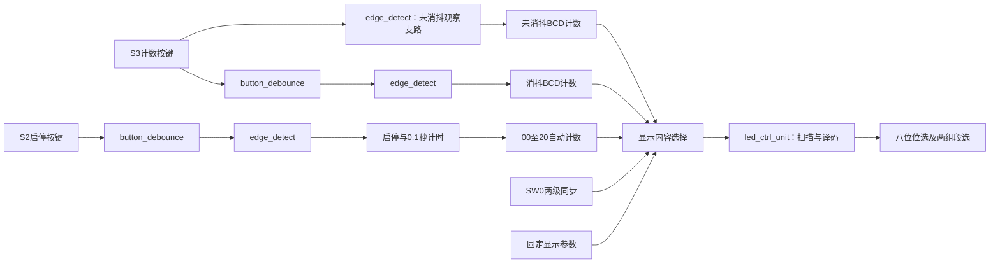

# Digital Logic Labs

**面向 EGO1 FPGA 的数字逻辑设计与验证项目**

[](https://github.com/peppaoinks/digital-logic-labs/actions/workflows/verify.yml)

从组合运算到时序存储，再到可配置流水灯和八位数码管控制器，本项目用四个递进的实验实现数字逻辑的基本构件，并提供源码、板级约束、仿真自检和工程生成入口。目标是让每个设计都能独立阅读、运行和验证，便于理解RTL行为以及修改后检查回归。

项目基于数字逻辑设计课程实验，包含 **5个独立硬件设计、9个RTL模块和13组仿真任务**。这些设计分别生成工程；目前没有将它们集成为同一个板级应用。

## 功能概览

| 设计 | 实现能力 | 关键设计点 |
|---|---|---|
| 使能加减运算器 | 4位加减法、禁用时输出1111 | 组合逻辑完整赋值，按模16处理溢出与借位 |
| D触发器 | 数据采样、使能保持、异步清零 | 复位优先级与同步更新 |
| 8×8位寄存器文件 | 8个字节独立存储、同步写、组合读 | 写使能、读写地址分离、全寄存器清零 |
| 可配置流水灯 | 2ms/100ms、双方向、单灯/相邻双灯 | 参数化计数、开关同步、运行中切换 |
| 八位数码管控制器 | 固定内容与分组数据显示、按键计数、自动计数及启停 | 动态扫描、双向消抖、一拍边沿脉冲、BCD回绕 |

## 项目结构

```text
digital-logic-labs/
├── lab1/                  # 组合运算器、课程激励、穷举测试
├── lab2/
│   ├── dff/               # 带使能D触发器
│   ├── reg8file/          # 8×8位寄存器文件
│   └── verification/     # 独立参考模型测试
├── lab3/                  # 独立计数器 + 流水灯顶层
├── lab4/                  # 显示顶层、扫描、消抖、边沿检测
├── scripts/
│   ├── verify.py          # 统一仿真入口
│   └── create_project.tcl # 五种设计的Vivado工程入口
├── docs/                  # 原理、架构、开发与验证说明
└── .github/workflows/     # 推送及PR自动验证
```

各设计目录保留自己的 `pin.xdc` 和仿真文件。波形、日志及Vivado工程集中生成在忽略跟踪的 `build/` 下。

## 学习讲义

[实验1至4：零基础学习讲义（PDF）](docs/lectures/lab1-4-learning-guide.pdf) · [阅读说明与LaTeX源码](docs/lectures/README.md)

覆盖基础概念、Verilog、四次实验原理、代码讲解与操作自测，附配套代码和源码编译说明。

## 快速开始

### 1. 获取项目

```sh
git clone https://github.com/peppaoinks/digital-logic-labs.git
cd digital-logic-labs
```

### 2. 准备环境

| 工具或硬件 | 用途 | 要求 |
|---|---|---|
| Python 3 | 执行统一验证脚本 | 无第三方Python包依赖 |
| Icarus Verilog | 编译并运行行为仿真 | `iverilog`、`vvp` 在PATH中，使用Verilog-2005模式 |
| AMD/Xilinx Vivado | 建工程、综合、实现与下载 | 需安装支持Artix-7的版本；本仓库尚未验证具体版本兼容性 |
| EGO1开发板 | 实物验证 | FPGA为 `xc7a35tcsg324-1`，板载时钟100MHz |

仅运行仿真时，准备Python和Icarus即可。Windows可用 `python` 替代以下命令中的 `python3`。

### 3. 运行验证

```sh
python3 scripts/verify.py         # 11组课程激励及功能自检
python3 scripts/verify.py --full  # 13组，增加真实默认计时参数验证
```

完整运行成功时最后一行为：

```text
PASS: 13 simulations completed.
```

每组测试单独编译并明确指定顶层，避免实验2两个同名 `testbench` 混编。日志位于 `build/<测试名>/compile.log` 和 `simulation.log`；含波形记录的测试在同一目录生成VCD，可用波形查看器打开。

### 4. 创建Vivado工程

在已配置Vivado环境的终端中选择一个设计：

```sh
vivado -mode gui -source scripts/create_project.tcl -tclargs lab1
vivado -mode gui -source scripts/create_project.tcl -tclargs dff
vivado -mode gui -source scripts/create_project.tcl -tclargs reg8file
vivado -mode gui -source scripts/create_project.tcl -tclargs lab3
vivado -mode gui -source scripts/create_project.tcl -tclargs lab4
```

工程生成到 `build/vivado/<顶层名>/`，重复执行打开已有工程。脚本设置芯片型号、设计顶层、仿真顶层并分别加入RTL、仿真源和约束；实验3工程名为 `flowing_water_lights`。该入口负责建工程，后续在Vivado中运行行为仿真、综合、实现及生成bit。

进入行为仿真后执行 `run all`。实验3/4保留波形配置脚本，路径及信号说明见[实验操作文档](docs/labs.md)。下载前确认所选工程、引脚约束和bit与当前源码一致。

## 架构与设计约定

时序设计使用100MHz主时钟，通过计满使能控制低速动作，避免用按键或计满脉冲派生时钟。RTL时序块使用非阻塞赋值，组合块使用阻塞赋值；组合运算器不设复位，其余设计使用高电平异步复位。

实验3将通用计数器与灯光位置控制分开；实验4用四个模块组织输入处理、计数和显示。其输入与显示路径如下：



实验4未消抖支路用于观察按键抖动；两级边沿检测结构保留课程要求，不能将这条观察支路当作完整的通用异步输入接口。模块职责、接口和计时参数见[架构说明](docs/architecture.md)。

## 验证与当前状态

验证分为课程激励、独立模型/功能自检和默认参数计时三个层次：实验1遍历全部1024种二进制输入；实验2覆盖全部地址与字节值写入，并交叉检查使能和清零；实验3/4检查模式切换、计时边界、扫描、消抖、长按和计数回绕。

| 验证层次 | 当前状态 |
|---|---|
| 本地Icarus完整仿真 | 13组通过 |
| GitHub Actions完整仿真 | 首次运行13组通过；后续状态见页首徽章 |
| Vivado工程入口 | 已提供；尚未在Vivado实机执行 |
| 当前整理版综合、实现、时序与上板 | 待验证 |

当前版本的上板验证待完成。行为仿真结果不代表物理时序收敛或真实按键的全部电气行为。

## 文档导航

| 文档 | 内容 |
|---|---|
| [完整学习讲义](docs/lectures/README.md) | PDF、LaTeX源码、配套代码与编译说明 |
| [实验原理与操作](docs/labs.md) | 功能、接线、控制开关、预期现象 |
| [模块架构](docs/architecture.md) | 模块边界、接口、参数、时钟与复位 |
| [验证说明](docs/verification.md) | 整理改动、测试覆盖及验证边界 |
| [开发指南](CONTRIBUTING.md) | 修改流程、编码约定、排错与移植 |

## 后续工作

- 在Vivado验证工程生成入口，记录实际使用的工具版本。
- 完成当前整理版五个设计的综合、实现和时序检查。
- 使用当前生成的bit逐项上板，补充可复现的操作结果。

项目由课程实验逐步整理，保留原有实验编号便于对照学习。仓库收录可维护的源码与验证材料；课程报告、个人证件照片和教材不纳入版本控制。请基于理解独立完成课程要求。
