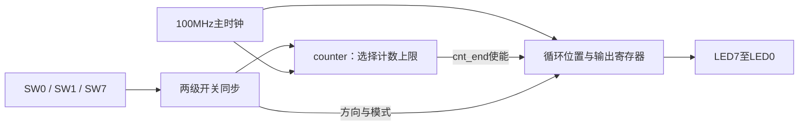

# 模块架构

## 设计边界

四个实验共五个独立顶层，分别使用各自的引脚约束；它们通过统一脚本管理和验证，没有共用一个综合顶层。

| 设计选择 | 顶层 | RTL依赖 | 仿真顶层 |
|---|---|---|---|
| lab1 | mux | 无 | mux_sim |
| dff | dff | 无 | testbench |
| reg8file | reg8file | 无 | testbench |
| lab3 | flowing_water_lights | counter | testbench |
| lab4 | lab4 | button_debounce、edge_detect、led_ctrl_unit | testbench；独立边沿测试为edge_testbench |

`lab2/dff/testbench.v` 与 `lab2/reg8file/testbench.v` 同名但属于不同工程，不能直接把全部仿真文件作为同一顶层编译。

## 组合与存储接口

| 模块 | 输入 | 输出 | 行为 |
|---|---|---|---|
| mux | en、mux_sel、input_a[3:0]、input_b[3:0] | output_c[3:0] | 禁用输出F；使能后选择4位加法或减法 |
| dff | clk、clr、en、d | q | clr优先；上升沿使能采样，否则保持 |
| reg8file | clk、clr、en、d[7:0]、wsel[2:0]、rsel[2:0] | q[7:0] | 上升沿按wsel写入，组合读取rsel |

实验2保留 `clr` 作为高有效异步复位端口名。寄存器文件清零所有8个字节；关闭写使能只阻止写入，不阻止读地址变化。写入与读出同一地址时，输出随该寄存器在时钟沿后的更新变化；实际电路的传播延迟由实现决定。

## 流水灯

`counter` 接收已同步的频率选择，输出当前计数 `cnt` 和计满条件 `cnt_end`。顶层保存单灯位置，在计满时循环移位并按模式生成灯光输出。复位固定为仅亮LED0；方向和单双灯模式在换灯沿生效。

| 参数 | 默认值 | 约束 |
|---|---:|---|
| WIDTH | 24 | 正整数；应能容纳两个计数上限 |
| CNT_MAX_FAST | 199999 | WIDTH位可表示的非负数 |
| CNT_MAX_SLOW | 9999999 | WIDTH位可表示的非负数 |

计数区间包含0和上限，周期为上限加1拍。快慢切换使用 `cnt >= cnt_max`，使慢切快时已有计数超过新上限也能结束当前周期。测试将位宽和上限一并覆盖为4位、6与11；修改上板速度无需改动顶层控制逻辑。

## 数码管控制器

`lab4` 负责连接四类逻辑：

1. SW0经过两级同步，在固定内容和指定分组内容间选择。
2. S2经同步、双向消抖和边沿检测，切换自动计数的运行状态。
3. S3分成未消抖与已消抖两条支路，各自驱动00至99的BCD计数。
4. 0.1秒使能驱动00至20自动计数，显示选择后交给扫描模块。

| 模块 | 输入 | 输出 | 职责 |
|---|---|---|---|
| button_debounce | clk、rst、button | button_clean | 两级同步；按下与释放均需连续稳定后确认 |
| edge_detect | clk、rst、signal | pos_edge | `sig_r0`、`sig_r1`两级级联，生成单拍上升沿脉冲 |
| led_ctrl_unit | clk、rst、display[31:0] | led_en[7:0]、led_cx[7:0]、led_cx1[7:0] | 按半字节取数，八位轮询，0至F译码 |

`display[3:0]` 对应 `led_en[0]`，依次向高位扫描。`scan_index[2]` 选择左右段选组；未选段选组输出0。位选和段选高有效，段码从高位至低位为A、B、C、D、E、F、G、DP。

| 顶层参数 | 位宽 | 默认值 | 用途 |
|---|---:|---|---|
| STUDENT_ID | 32 | 32'h25310489 | 8个半字节的固定显示；低8位同时用于指定模式最左两位 |
| SCAN_MAX | 17 | 99999 | 每位停留100000拍，即1ms |
| DEBOUNCE_MAX | 21 | 1999999 | 对同步后的输入观察2000000拍稳定状态 |
| TICK_MAX | 24 | 9999999 | 自动计数每10000000拍更新一次 |

这些计时参数应在各自位宽可表示的非负范围内。单纯修改 `STUDENT_ID` 会同时修改固定显示和指定显示前两位。它存放的是显示数字的半字节编码，不是一个需要进行十进制转换的32位整数。

暂停保留自动计数及当前周期的累计拍数；手动按键计数和扫描继续运行。切换显示模式只改变显示来源，所有后台计数继续保持各自行为。

## 时钟、复位与异步输入

所有时序块只使用 `clk` 上升沿，高电平 `rst` / `clr` 可异步清零。复位后由后续时钟恢复正常更新；按键、开关和计满条件均不驱动时钟端口。

实验3开关同步寄存器、实验4模式同步寄存器及消抖模块输入同步寄存器带有 `ASYNC_REG` 属性。属性用于帮助实现工具识别同步链，本身不消除所有物理风险；复位释放、跨域路径及板级输入仍须结合Vivado时序和硬件验证评估。

实验4的未消抖支路保留两级边沿检测课程结构，比较第一拍和第二拍采样值。它用于演示抖动影响，不能替代在稳定同步输出后检测边沿的通用输入处理方案。

## 参数化与移植

更换时钟频率时，按 `计数上限 = 目标时间 × 时钟频率 - 1` 重算所有计时上限，并检查位宽是否足够。默认复位极性、数码管极性、段码顺序与引脚映射针对EGO1，其他开发板须分别调整；不能只替换芯片型号。
